<h3><code>jerry@github ~ $ ./contributions.sh</code></h3>

  

<h3><code>jerry@github ~ $ whoami</code></h3>
<table>
  <tr>
    <td valign="top"></td>
    <td valign="top"></td>
  </tr>
</table>

 

<h3><code>jerry@github ~ $ cat links.txt</code></h3>
<a href="https://jerry-portfolio-sepia.vercel.app/"><code>portfolio</code></a> ·
<a href="https://www.linkedin.com/in/jerryson-gunaseelan-281b76379"><code>linkedin</code></a> ·
<a href="https://github.com/JerryOffiicial?tab=repositories"><code>repositories</code></a>

